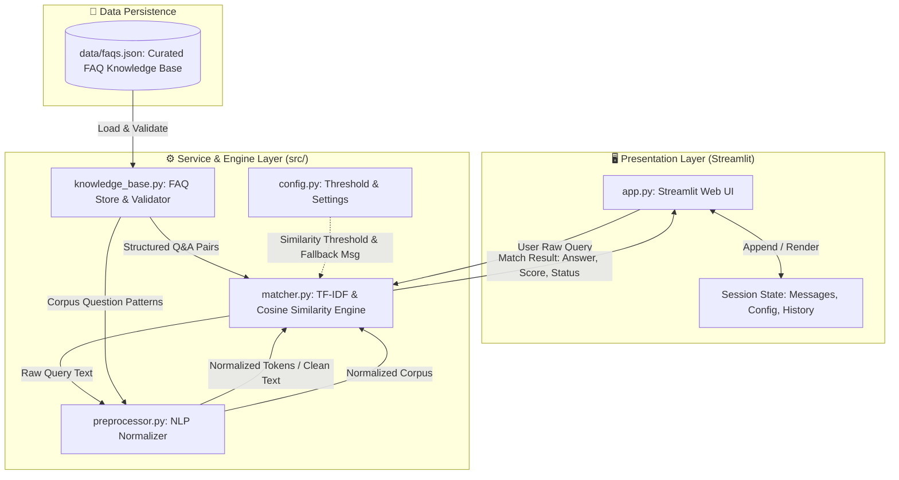
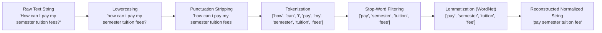
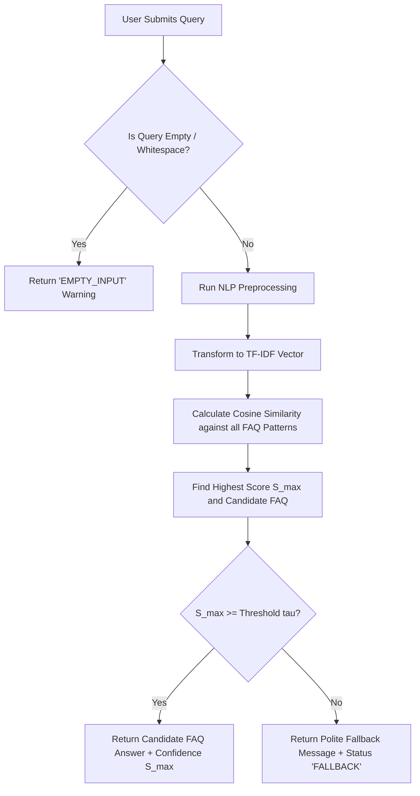

# 🏛️ System Architecture Specification — FAQ Chatbot

> **Document Version:** 1.0.0  
> **Status:** Stage 0 Blueprint (Pending Approval)  
> **Author:** CodeAlpha AI Intern / Senior Architect

---

## 1. Architectural Overview

The **Intelligent FAQ Chatbot** is built upon a modular, layered vector-space information retrieval architecture. It decouples the presentation layer (Streamlit UI) from the underlying Natural Language Processing (NLP) text pipeline, the mathematical vectorizer, and the data repository.

The system operates deterministically on local computational resources without dependencies on third-party cloud LLMs or paid API keys.

---

## 2. High-Level System Architecture Diagram

---

## 3. Module Responsibilities and Boundaries

The application is decomposed into cohesive, loosely coupled modules under the `src/` namespace:

### 3.1 `src/config.py` (Configuration Provider)
- **Role**: Central source of truth for runtime hyperparameters, constants, and paths.
- **Responsibilities**:
  - Load environment settings with safe defaults (e.g., `SIMILARITY_THRESHOLD = 0.30`).
  - Define system messages (e.g., `FALLBACK_MESSAGE`, `EMPTY_INPUT_WARNING`).
  - Specify file paths (`FAQ_DATA_PATH = "data/faqs.json"`).
  - Prevent hardcoded strings across application modules.

### 3.2 `src/knowledge_base.py` (Data Repository & Validator)
- **Role**: Access layer for curated FAQ knowledge assets.
- **Responsibilities**:
  - Ingest FAQ data from `data/faqs.json`.
  - Validate schema integrity (presence of `id`, `category`, `question`, `patterns`, `answer`).
  - Extract indexed document entries: creates flattened training items pairing each pattern variation with its target answer and identifier.
  - Expose defensive error handling if the file is missing or corrupted.

### 3.3 `src/preprocessor.py` (NLP Normalization Pipeline)
- **Role**: Deterministic text sanitization and linguistic normalization.
- **Responsibilities**:
  - Lowercase normalization: eliminates casing discrepancies.
  - Special character and punctuation stripping: retains alphanumeric terms.
  - Tokenization: splits input into individual word tokens.
  - Stop-word removal: filters non-informative English function words (e.g., "the", "is", "at") using NLTK stop words while preserving critical question words.
  - Lemmatization: converts inflected forms to dictionary base forms using NLTK `WordNetLemmatizer` (e.g., *"registering"* $\rightarrow$ *"register"*, *"fees"* $\rightarrow$ *"fee"*).
  - Whitespace compaction: collapses redundant spaces.

### 3.4 `src/matcher.py` (Vectorization & Similarity Engine)
- **Role**: Mathematical vector representation and nearest-neighbor retrieval.
- **Responsibilities**:
  - Fit `TfidfVectorizer` from `scikit-learn` on normalized FAQ question patterns.
  - Cache fitted vectorizer and document matrix for instant query inference ($O(1)$ startup fitting for moderate corpora).
  - Transform incoming preprocessed user queries into the TF-IDF vector space.
  - Compute Cosine Similarity between user query vector and all FAQ pattern vectors.
  - Rank similarity scores and identify highest-scoring candidate $S_{max}$.
  - Execute threshold evaluation:
    - If $S_{max} \ge \tau$ (where $\tau$ is `SIMILARITY_THRESHOLD`), return matched FAQ item with status `MATCH_FOUND`.
    - If $S_{max} < \tau$, return `FALLBACK_TRIGGERED` with the polite default response.
  - Detect empty or whitespace-only queries and return `EMPTY_QUERY`.

### 3.5 `app.py` (Streamlit Presentation Controller)
- **Role**: Interactive web presentation and session lifecycle management.
- **Responsibilities**:
  - Render modern chat UI using `st.chat_message` and `st.chat_input`.
  - Manage in-memory session history via `st.session_state.messages`.
  - Provide a configuration sidebar (viewing current threshold, dataset size, categories).
  - Render quick-action suggestion chips for sample queries.
  - Display confidence score metrics (in transparent, non-calibrated format) when enabled.
  - Provide a "Clear Chat" action to reset session state.

---

## 4. NLP Preprocessing Pipeline

The preprocessing pipeline ensures that semantic intent is aligned across grammatical variations:

### Preprocessing Invariants:
1. **Idempotence**: Applying `preprocess(preprocess(text))` yields identical output.
2. **Deterministic Output**: For identical input, identical token sequences are guaranteed.
3. **Graceful Handling of Edge Cases**: Numeric terms (e.g., "course 101", "2026") are preserved; purely symbolic input (e.g., `"???"`) reduces to empty string safely.

---

## 5. Mathematical Vectorization & Similarity Matching

### 5.1 TF-IDF Representation
The Term Frequency-Inverse Document Frequency (TF-IDF) assigns mathematical weights to terms in a vocabulary $V$:

$$\text{TF}(t, d) = \frac{f_{t,d}}{\sum_{t' \in d} f_{t', d}}$$

$$\text{IDF}(t, D) = \ln\left(\frac{1 + |D|}{1 + |\{d \in D : t \in d\}|}\right) + 1$$

$$\text{TF-IDF}(t, d, D) = \text{TF}(t, d) \times \text{IDF}(t, D)$$

Each FAQ question pattern $d_i$ and the user query $q$ are represented as $L_2$-normalized vectors:
$$\mathbf{v}_{d_i} \in \mathbb{R}^{|V|}, \quad \mathbf{u}_q \in \mathbb{R}^{|V|}$$

### 5.2 Cosine Similarity Calculation
The similarity score $S(q, d_i)$ measures the cosine of the angle between query vector $\mathbf{u}_q$ and FAQ vector $\mathbf{v}_{d_i}$:

$$\text{Cosine Similarity}(\mathbf{u}_q, \mathbf{v}_{d_i}) = \frac{\mathbf{u}_q \cdot \mathbf{v}_{d_i}}{\|\mathbf{u}_q\|_2 \|\mathbf{v}_{d_i}\|_2}$$

Because vectors are $L_2$-normalized by `TfidfVectorizer(norm='l2')`, this simplifies to the inner product:
$$S(q, d_i) = \mathbf{u}_q \cdot \mathbf{v}_{d_i} \quad \in [0.0, 1.0]$$

---

## 6. Threshold Handling & Fallback Logic

### Threshold Rules:
- **Default Threshold ($\tau$)**: Set to `0.30` based on empirical analysis of TF-IDF n-gram matches.
- **Strict Distinction**: Scores are reported strictly as **Cosine Similarity Scores (0.00 – 1.00)**, never mischaracterized as Bayesian or calibrated probabilities.
- **Configurability**: $\tau$ is configurable via `.env` / `config.py` and can be adjusted interactively in the Streamlit testing sidebar.

---

## 7. Fault Tolerance & Exception Handling

| Error Category | Root Cause | System Defense | User Feedback |
| :--- | :--- | :--- | :--- |
| **Missing Knowledge Base** | `faqs.json` not found | `FileNotFoundError` caught in `knowledge_base.py` | UI error banner; guidance to verify data path |
| **Invalid Schema** | Corrupted JSON or missing keys | `KeyError`/`JSONDecodeError` validation | Graceful warning; skips malformed entries |
| **Corpus Missing Stopwords** | NLTK data not pre-downloaded | Automatic lazy download fallback with logging | Silent bootstrap or descriptive error |
| **Out-of-Vocabulary (OOV)** | Query contains zero corpus words | Zero vector $\mathbf{u}_q = \mathbf{0}$; $S_{max} = 0.0$ | Fallback response triggered cleanly |
| **Empty Input** | User hits Enter with whitespace | Length validation before vectorization | Informative warning prompt |
