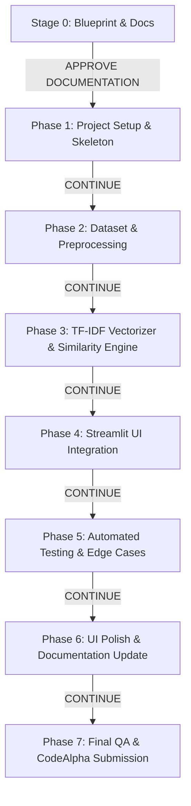

# 🗺️ Implementation Plan — FAQ Chatbot

> **Document Version:** 1.0.0  
> **Status:** Stage 0 Blueprint (Pending Approval)  
> **Workflow Rule:** Sequential, approval-driven implementation. No phase starts without explicit prior approval.

---

## 1. Phased Sequence Overview

The implementation roadmap is partitioned into seven distinct, incremental phases. Each phase represents a self-contained unit of work with clear deliverables, file modifications, risk profiles, and verification criteria.

---

## 2. Granular Phase Specifications

---

### Phase 1: Project Setup and Application Skeleton

- **Objective**: Establish the project directory hierarchy, define pinned runtime and testing dependencies, configure environment defaults, and ensure importable package modules.
- **Expected File Modifications**:
  - Create `requirements.txt`
  - Create `src/__init__.py`
  - Create `src/config.py`
  - Create `data/.gitkeep` (or initial placeholder)
  - Create `tests/__init__.py`
- **Implementation Strategy**:
  - Specify exact dependencies (`streamlit`, `scikit-learn`, `nltk`, `pytest`, `python-dotenv`).
  - Implement `src/config.py` as a centralized, immutable dataclass or module exporting default constants (`SIMILARITY_THRESHOLD = 0.30`, `FALLBACK_MESSAGE`, `FAQ_DATA_PATH`).
- **Verification Approach**:
  - Verify Python virtual environment creation and package imports.
  - Verify syntax and import resolution of `src.config`.
- **Phase Acceptance Criteria**:
  - `requirements.txt` exists and installs cleanly without conflicts.
  - `src.config` imports successfully with all required constants defined.
- **Risks & Mitigations**:
  - *Risk*: Dependency version mismatches across Python versions.
  - *Mitigation*: Pin known-compatible modern versions (e.g., `scikit-learn>=1.3.0`, `streamlit>=1.30.0`).
- **Approval Gate**: Stop and present actual verification results; await user command `CONTINUE`.

---

### Phase 2: FAQ Dataset & NLP Preprocessing Engine

- **Objective**: Author a curated, realistic FAQ dataset for Campus Services and build the NLTK-driven text sanitization, tokenization, stop-word removal, and lemmatization pipeline.
- **Expected File Modifications**:
  - Create `data/faqs.json`
  - Create `src/knowledge_base.py`
  - Create `src/preprocessor.py`
  - Create `tests/test_knowledge_base.py`
  - Create `tests/test_preprocessor.py`
- **Implementation Strategy**:
  - Design `data/faqs.json` containing 20+ FAQ entries across 5 categories (Admissions, Course Registration, Tuition & Finance, Campus Services & ID, Academic Policies). Each entry contains canonical question, multiple natural paraphrases, verified answer, and category.
  - In `src/knowledge_base.py`, implement `FAQKnowledgeBase` class with schema validation and extraction of flattened `(pattern, answer, faq_id)` training pairs.
  - In `src/preprocessor.py`, implement `TextPreprocessor` wrapping lowercasing, regex punctuation stripping, tokenization, NLTK stop-word removal, and WordNet lemmatization. Include automatic lazy download of NLTK corpora if not locally present.
- **Verification Approach**:
  - Run `pytest tests/test_knowledge_base.py` (validates schema, JSON parsing, error handling on missing file).
  - Run `pytest tests/test_preprocessor.py` (validates casing, punctuation stripping, lemmatization of plurals and verb forms, empty string behavior).
- **Phase Acceptance Criteria**:
  - `faqs.json` validates with 20+ questions and 60+ total pattern variants.
  - Preprocessor correctly transforms test cases (e.g., `"How do I pay semester fees?"` $\rightarrow$ `"pay semester fee"`).
  - 100% pytest pass rate.
- **Risks & Mitigations**:
  - *Risk*: NLTK data download failure behind corporate firewalls or offline environments.
  - *Mitigation*: Include robust try/except logic that attempts local cache first, attempts quiet download, or falls back to standard regex tokenization if offline.
- **Approval Gate**: Stop, report actual test execution table, and await user command `CONTINUE`.

---

### Phase 3: TF-IDF Vectorization, Similarity Matching & Fallback

- **Objective**: Construct the vector-space model using scikit-learn's `TfidfVectorizer`, calculate Cosine Similarity between user queries and corpus patterns, and enforce similarity threshold and fallback rules.
- **Expected File Modifications**:
  - Create `src/matcher.py`
  - Create `tests/test_matcher.py`
- **Implementation Strategy**:
  - Implement `FAQMatcher` class:
    - Fits `TfidfVectorizer(ngram_range=(1, 2), norm='l2', sublinear_tf=True)` on preprocessed patterns from `knowledge_base`.
    - Caches pattern vectors and mapping back to parent FAQ objects.
    - Exposes `match(query: str) -> MatchResult`.
    - Handles empty/whitespace input immediately (`status="EMPTY_QUERY"`).
    - Transforms query using the fitted vectorizer; calculates cosine similarity vector.
    - Finds index of maximum score $S_{max}$.
    - Compares $S_{max}$ with threshold $\tau$. If $S_{max} \ge \tau$, returns answer with `status="MATCH_FOUND"`. If $S_{max} < \tau$, returns `FALLBACK_MESSAGE` with `status="FALLBACK"`.
- **Verification Approach**:
  - Run `pytest tests/test_matcher.py`:
    - Test exact match queries (expect score $\approx 1.0$).
    - Test paraphrased queries (expect score $\ge 0.35$).
    - Test completely irrelevant queries (expect score $< 0.20$ and fallback message).
    - Test empty strings and whitespace (expect empty query warning).
- **Phase Acceptance Criteria**:
  - Exact and paraphrased queries return correct FAQ answers.
  - Irrelevant queries cleanly trigger fallback.
  - 100% pytest pass rate.
- **Risks & Mitigations**:
  - *Risk*: Single-word queries may fail threshold if IDF weights are too low.
  - *Mitigation*: Enable unigram + bigram n-grams and tune threshold to default 0.30, validated across test queries.
- **Approval Gate**: Stop, report test outcomes, and await user command `CONTINUE`.

---

### Phase 4: Streamlit Chat Interface & Engine Integration

- **Objective**: Develop the responsive, aesthetically superior Streamlit conversational interface, integrating it with the underlying matcher engine and session state.
- **Expected File Modifications**:
  - Create `app.py`
  - Create `.streamlit/config.toml` (for theme colors and server config)
- **Implementation Strategy**:
  - Implement modern layout adhering to `design.md` specifications.
  - Initialize session state: `messages`, `engine`, `threshold_override`, `show_confidence`.
  - Build landing empty-state with friendly welcome banner and interactive suggestion chips.
  - Build chat message stream using `st.chat_message("user")` and `st.chat_message("assistant")`.
  - Build sidebar with dataset statistics (total FAQs, categories), threshold adjustment slider for testing, confidence score toggle, and "Clear Conversation" button.
  - Connect `st.chat_input` to `FAQMatcher.match()`.
- **Verification Approach**:
  - Launch Streamlit in headless test mode or run integration test to verify clean app startup.
  - Test submitting a suggested question, custom question, and clearing history.
- **Phase Acceptance Criteria**:
  - Chat interface launches without errors.
  - Messages appear in correct conversational bubbles with timestamps/confidence chips.
  - Suggestion chips trigger expected query execution.
  - "Clear Conversation" successfully empties state.
- **Risks & Mitigations**:
  - *Risk*: Streamlit re-running the entire script on each interaction, re-fitting the vectorizer every turn.
  - *Mitigation*: Cache the `FAQMatcher` instance using `@st.cache_resource` for instantaneous response ($< 10\text{ ms}$).
- **Approval Gate**: Stop, report interface verification results, and await user command `CONTINUE`.

---

### Phase 5: Automated Testing, Edge Cases & Regression

- **Objective**: Solidify code reliability by developing comprehensive edge-case tests, full dataset regression validation, and coverage reporting.
- **Expected File Modifications**:
  - Create `tests/test_edge_cases.py`
  - Create `tests/test_regression.py`
- **Implementation Strategy**:
  - `test_edge_cases.py`: Long queries (> 500 chars), punctuation-only queries (`"??!..."`), emojis, mixed alphanumeric codes, out-of-vocabulary foreign words.
  - `test_regression.py`: Iterates over every canonical question in `data/faqs.json` and verifies that it maps directly to its intended FAQ ID.
- **Verification Approach**:
  - Run full suite: `pytest -v --durations=10`.
- **Phase Acceptance Criteria**:
  - Every canonical FAQ query matches its own answer with score $> 0.80$.
  - All edge cases handled safely without unhandled exceptions.
  - 100% of all tests pass.
- **Risks & Mitigations**:
  - *Risk*: A future FAQ addition could cause vocabulary drift or collision with another category.
  - *Mitigation*: Automated regression test detects collisions immediately.
- **Approval Gate**: Stop, present test summary table, and await user command `CONTINUE`.

---

### Phase 6: UI Polish, Accessibility & Documentation Update

- **Objective**: Perfect visual aesthetics, verify WCAG 2.1 AA accessibility, refine typography/spacing, and update all project documentation.
- **Expected File Modifications**:
  - Update `README.md` (add usage walk-through, screenshots/ASCII layout, verified test badges).
  - Update `memory.md` (record completed phases, final metrics).
  - Refine `app.py` CSS styling.
- **Implementation Strategy**:
  - Review color contrast and keyboard navigation.
  - Ensure zero layout jitter or overflow.
  - Polish markdown formatting of FAQ answers.
- **Verification Approach**:
  - Manual visual inspection and contrast audit.
- **Phase Acceptance Criteria**:
  - Visuals adhere to deep slate/indigo theme.
  - Documentation accurately reflects the final application state.
- **Approval Gate**: Stop, report QA results, and await user command `CONTINUE`.

---

### Phase 7: GitHub Readiness & CodeAlpha Submission Checklist

- **Objective**: Package the repository for submission to the CodeAlpha internship portal, ensuring code quality, zero secret leaks, and complete setup reproducibility.
- **Expected File Modifications**:
  - Clean up temporary files, caches, and test artifacts.
  - Verify `.gitignore` coverage.
  - Author `SUBMISSION_CHECKLIST.md` or submission summary.
- **Implementation Strategy**:
  - Run linting / formatting checks (PEP 8 compliance).
  - Confirm repository can be cloned and run from scratch following `README.md` instructions.
- **Verification Approach**:
  - Verify clean git status (no untracked unwanted files).
- **Phase Acceptance Criteria**:
  - 100% of tasks in `task.md` marked completed.
  - Clean repository ready for submission.
- **Approval Gate**: Present final submission summary and await user sign-off.
