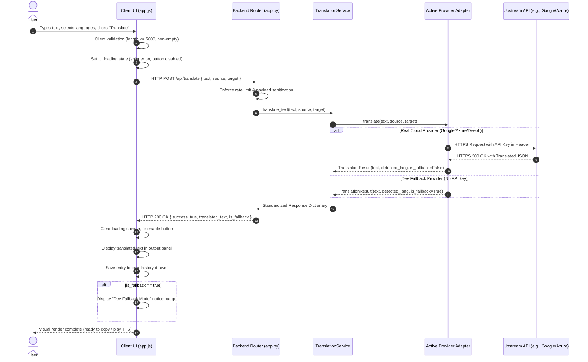

# System Architecture Specification
## Project: Language Translation Tool (Task 1)
**Program:** CodeAlpha Artificial Intelligence Internship  
**Document Status:** Pending Approval (Stage 0)  
**Author:** AI Engineering & Architecture Team  
**Last Updated:** 2026-10-27  

---

## 1. Architectural Philosophy & Overview

The **Language Translation Tool** is engineered as a secure, decoupled, and high-performance translation system. It employs a **Single-Process Lightweight Server Architecture** combining a robust Python backend with a modern, reactive Vanilla Web Frontend. 

### Core Architectural Goals
1. **Zero Secret Leakage (Security by Isolation)**: Third-party translation API credentials never leave the server process. The browser client communicates exclusively with our internal backend proxy.
2. **Pluggable Provider Pattern (Extensibility)**: Translation engines (Google Cloud, Azure Translator, DeepL, MyMemory, and Dev Fallback) adhere to a unified interface (`TranslationProvider`), making providers hot-swappable without touching core application logic.
3. **Zero Build-Step Frontend (Simplicity & Maintainability)**: The frontend leverages modern Web standards (HTML5 semantic tags, CSS3 custom properties with glassmorphism, and modern asynchronous JavaScript ES6+). It eliminates heavy Node.js/npm bundling dependencies, enabling instant startup with pure Python.
4. **Resilient Error Propagation**: Comprehensive failure isolation ensuring that network timeouts, rate limits, and malformed inputs are caught gracefully, sanitized, and communicated clearly to the user.

---

## 2. System Architecture Diagram

```mermaid
graph TD
    subgraph Client ["Client Tier (Browser)"]
        UI["Web UI (Vanilla HTML5 / CSS3 / ES6+)"]
        State["State Manager (Theme, History, Audio)"]
        TTS["Web Speech API (Text-to-Speech)"]
        Clip["Clipboard API (Copy)"]
        UI <--> State
        UI --> TTS
        UI --> Clip
    end

    subgraph Server ["Server Tier (Python App Service)"]
        Router["HTTP Router / API Controller (/api/*)"]
        Config["Configuration & Env Manager (python-dotenv)"]
        Validator["Input Validation & Sanitization Engine"]
        Service["Translation Orchestrator (TranslationService)"]
        
        Router --> Validator
        Validator --> Service
        Config --> Service
    end

    subgraph Providers ["Translation Provider Adapter Layer"]
        Base["<<interface>> TranslationProvider"]
        P_Google["GoogleCloudProvider"]
        P_Azure["AzureTranslatorProvider"]
        P_DeepL["DeepLProvider"]
        P_MyMemory["MyMemoryProvider"]
        P_Fallback["DevEchoFallbackProvider"]

        Base <|-- P_Google
        Base <|-- P_Azure
        Base <|-- P_DeepL
        Base <|-- P_MyMemory
        Base <|-- P_Fallback

        Service --> Base
    end

    subgraph External ["External Cloud APIs"]
        GCP_API["Google Cloud Translation API"]
        AZ_API["Azure Cognitive Services Translator"]
        DL_API["DeepL REST API v2"]
        MM_API["MyMemory Translated API"]

        P_Google -.->|HTTPS / API Key| GCP_API
        P_Azure -.->|HTTPS / Secret Key| AZ_API
        P_DeepL -.->|HTTPS / Auth Key| DL_API
        P_MyMemory -.->|HTTPS / Free REST| MM_API
    end

    UI -->|JSON Request POST /api/translate| Router
    Router -->|JSON Response (Result / Error)| UI
```

---

## 3. Tier Responsibilities

### 3.1 Client Tier (Frontend)
- **Rendering & Presentation**: Renders the dual-panel translation card layout, input counter, buttons, and state indicators.
- **Client-Side Validation**: Ensures text is non-empty and does not exceed 5,000 characters before network dispatch.
- **Asynchronous Communications**: Dispatches `fetch()` requests with timeout abort signals (`AbortController`) to backend endpoints.
- **User Ergonomics**:
  - Web Speech API integration for local browser audio pronunciation.
  - Clipboard API interaction for instant copying with visual tooltip feedback.
  - LocalStorage management for persistent theme (Dark/Light) and translation history (last 10 entries).
  - Language swap logic (reversing text and dropdown selections).

### 3.2 Server Tier (Backend)
- **Static Asset Serving**: Serves `index.html`, `style.css`, and `app.js` efficiently from the `static/` directory.
- **RESTful Endpoints**:
  - `GET /` — Serves main translation single page application.
  - `POST /api/translate` — Accepts payload `{ text, source_lang, target_lang }`, validates, dispatches to active provider, and returns normalized translation.
  - `GET /api/languages` — Returns dictionary of supported languages and active provider metadata.
  - `GET /api/health` — Returns system health status, active provider name, and configuration readiness.
- **Configuration & Secret Protection**: Loads `.env` file variables securely, ensuring credentials never leak into response bodies or logs.
- **Sanitization & Boundary Protection**: Enforces UTF-8 normalization, strips dangerous control characters, enforces rate limits, and bounds payload sizes.

### 3.3 Provider Adapter Layer
- Implements the **Adapter Design Pattern**.
- Exposes a uniform method:
  ```python
  def translate(self, text: str, source_lang: str, target_lang: str) -> TranslationResponse:
      """Translates input text from source to target language."""
      ...
  ```
- Normalizes diverse upstream JSON structures into a unified internal model:
  ```json
  {
    "success": true,
    "translated_text": "Bonjour le monde",
    "detected_source_lang": "en",
    "target_lang": "fr",
    "provider": "google",
    "is_fallback": false,
    "timestamp": "2026-10-27T11:20:00Z"
  }
  ```

---

## 4. Component & Module Breakdown

```
Language_Translation_Tool_Task1/
│
├── app.py                          # Application entry point & route definitions
├── config.py                       # Environment variables, constants & settings
├── requirements.txt                # Pinned production and test dependencies
├── .env.example                    # Template environment variables
├── .gitignore                      # Git exclusion rules
├── README.md                       # Main project README
│
├── services/                       # Business logic services
│   ├── __init__.py
│   ├── translation_service.py     # Provider dispatch and validation logic
│   └── language_service.py        # Language catalog and ISO 639-1 mappings
│
├── providers/                      # Pluggable translation adapters
│   ├── __init__.py
│   ├── base.py                    # Abstract Base Class: TranslationProvider
│   ├── google_provider.py         # Google Cloud Translation implementation
│   ├── azure_provider.py          # Microsoft Azure Translator implementation
│   ├── deepl_provider.py          # DeepL API implementation
│   ├── mymemory_provider.py       # MyMemory free translation implementation
│   └── fallback_provider.py       # Local development fallback provider
│
├── static/                         # Frontend assets (no build-step required)
│   ├── index.html                 # Semantic single-page HTML layout
│   ├── css/
│   │   └── style.css              # Glassmorphic, responsive design system
│   └── js/
│       ├── app.js                 # UI controllers, event listeners & API client
│       └── languages.js           # Client-side language dictionary & helpers
│
├── tests/                          # Automated test suite
│   ├── __init__.py
│   ├── conftest.py                # Pytest fixtures and test clients
│   ├── test_app.py                # Endpoint routing and integration tests
│   ├── test_translation_service.py# Business logic and validation tests
│   └── test_providers.py          # Provider unit tests with mock responses
│
└── docs/                           # Project planning and architecture docs
    ├── prd.md
    ├── architecture.md
    ├── design.md
    ├── implementation_plan.md
    ├── task.md
    ├── DECISIONS.md
    └── memory.md
```

---

## 5. End-to-End Data Flow Sequence



---

## 6. Error Handling Strategy

| Error Class | Root Cause | Server Response | Frontend UX Behavior |
| :--- | :--- | :--- | :--- |
| **Validation Error** | Text exceeds 5,000 characters or contains illegal control characters. | HTTP 400 Bad Request `{ "error": "Text exceeds maximum allowed length of 5000 characters." }` | Amber inline warning banner under text box; no API dispatch. |
| **Missing Input** | Empty string or whitespace-only submitted. | HTTP 400 Bad Request `{ "error": "Input text cannot be empty." }` | Highlights input box with subtle red pulse; auto-focuses cursor. |
| **Auth Failure** | Upstream API key expired, invalid, or revoked. | HTTP 502 Bad Gateway `{ "error": "Upstream translation provider authentication failed." }` | Red error banner explaining API key invalidity; suggests checking `.env`. |
| **Rate Limit (Upstream)** | Quota exceeded on Google/Azure/DeepL (HTTP 429). | HTTP 429 Too Many Requests `{ "error": "Upstream rate limit reached. Please wait a moment." }` | Warning badge: "Provider rate limit reached. Retrying available in 30 seconds." |
| **Network Timeout** | Connection drops or upstream takes >10 seconds. | HTTP 504 Gateway Timeout `{ "error": "Translation request timed out." }` | Notification banner: "Request timed out. Please check your internet connection." |
| **Unsupported Language** | Client requested unrecognized ISO code. | HTTP 400 Bad Request `{ "error": "Target language 'xyz' is not supported." }` | UI language dropdown resets to default; informative error shown. |

---

## 7. Security Architecture

1. **Defense-in-Depth for Credentials**:
   - Upstream API keys (`GOOGLE_TRANSLATE_API_KEY`, `AZURE_TRANSLATOR_KEY`, `DEEPL_API_KEY`) are stored strictly in server-side environment variables via `python-dotenv`.
   - The client receives only processed translation text; headers and metadata do not disclose upstream tokens or account IDs.
2. **Input Sanitization & Length Caps**:
   - Hard upper limit of **5,000 characters** per request to prevent buffer overflow and excessive API consumption charges.
   - Stripping of null bytes (`\0`) and sanitization against HTML injection in output rendering (using DOM `textContent` rather than `innerHTML`).
3. **CORS & Origin Hardening**:
   - The application serves both frontend assets and API endpoints from the same origin by default. 
   - External cross-origin requests can be strictly restricted or allowed only for specified development ports.
4. **No Sensitive Data Logging**:
   - Application logger logs metadata only (request duration, status code, character count, provider name). User-entered translation text and credentials are never written to disk or console logs.

---

## 8. Technology Stack Evaluation & Recommendation

| Component | Evaluated Options | Recommended Choice | Rationale |
| :--- | :--- | :--- | :--- |
| **Backend Framework** | Flask vs. FastAPI vs. Streamlit | **Flask (Python 3.13)** *(or FastAPI)* | Flask is clean, standard in Python, minimal, has zero complex async overhead, and effortlessly serves both static HTML/CSS/JS and JSON REST API routes in under 50 lines of core code. Streamlit was considered, but Flask provides superior UI flexibility, seamless custom glassmorphic styling, and direct control over browser audio/clipboard APIs. |
| **Frontend Stack** | React/Vite vs. Streamlit vs. Vanilla Web (HTML5/CSS3/ES6) | **Modern Vanilla Web (HTML5 + CSS3 + ES6 JS)** | Eliminates Node/npm build dependencies; loads instantly; 100% customizable; runs on any standard browser; zero package installation headaches for evaluators. |
| **HTTP Client** | `requests` vs. `httpx` vs. `urllib3` | **`requests`** | Industry standard for Python, rock-solid stability, straightforward timeout handling, and ubiquitous compatibility. |
| **Test Suite** | `unittest` vs. `pytest` | **`pytest`** | Clean assertion syntax, rich fixture ecosystem (`test_client`), and concise test reports. |

---

## 9. Architecture Decision Summary

All significant architectural choices are formally documented as Architecture Decision Records in [`DECISIONS.md`](file:///c:/Users/Udoy/Desktop/Varsity/codealpha_tasks/Language_Translation_Tool_Task1/docs/DECISIONS.md):
- **ADR-001**: Single-Process Python Server with Decoupled Vanilla Web Frontend.
- **ADR-002**: Pluggable Translation Provider Architecture with Explicit Development Fallback.
- **ADR-003**: Micro-Framework Selection (Flask).
- **ADR-004**: Zero-Build-Step Modern CSS Design System.
- **ADR-005**: Strict Environment-Variable Secret Management via `.env`.
- **ADR-006**: Dual-Strategy Text-to-Speech (Web Speech API with graceful fallback).
