# Implementation Plan
## Project: Language Translation Tool (Task 1)
**Program:** CodeAlpha Artificial Intelligence Internship  
**Document Status:** Pending Approval (Stage 0)  
**Author:** Technical Project Manager & Lead Architect  
**Last Updated:** 2026-10-27  

---

## 1. Execution Principles & Approval Protocol

1. **Strict Gate Enforcement**: Under no circumstances will implementation proceed to Phase 1 until the user explicitly responds with **`APPROVE DOCUMENTATION`**.
2. **Phase Boundary Containment**: Each subsequent phase will execute in strict isolation. At the conclusion of each phase, comprehensive verification tests will run, documentation will be updated, and the agent will halt and request **`CONTINUE`** from the user.
3. **No Unapproved Side-Effects**: No package installations, source code generation, or Git commits will be performed outside the currently authorized phase.

---

## 2. Phased Roadmap Overview

```mermaid
graph LR
    P0["Stage 0: Discovery & Documentation (ACTIVE)"] --> Gate0{"User: APPROVE DOCUMENTATION"}
    Gate0 --> P1["Phase 1: Setup & Application Skeleton"]
    P1 --> Gate1{"User: CONTINUE"}
    Gate1 --> P2["Phase 2: UI & Responsive Design"]
    P2 --> Gate2{"User: CONTINUE"}
    Gate2 --> P3["Phase 3: Translation API Integration"]
    P3 --> Gate3{"User: CONTINUE"}
    Gate3 --> P4["Phase 4: Optional Features (TTS, Copy, History)"]
    P4 --> Gate4{"User: CONTINUE"}
    Gate4 --> P5["Phase 5: Automated Testing & Edge Cases"]
    P5 --> Gate5{"User: CONTINUE"}
    Gate5 --> P6["Phase 6: Security Audit & Quality Assurance"]
    P6 --> Gate6{"User: CONTINUE"}
    Gate6 --> P7["Phase 7: Demo Readiness & Final Submission"]
```

---

## 3. Phase Specifications

### Phase 0: Discovery, Architecture & Documentation (Current Phase)
- **Objective**: Inspect workspace, establish architectural guardrails, document requirements, and prepare configuration templates without writing application code.
- **Deliverables**:
  - `README.md`
  - `.env.example`
  - `.gitignore`
  - `docs/prd.md`
  - `docs/architecture.md`
  - `docs/design.md`
  - `docs/DECISIONS.md`
  - `docs/implementation_plan.md`
  - `docs/task.md`
  - `docs/memory.md`
- **Verification Strategy**:
  - File presence verification in `Language_Translation_Tool_Task1/`.
  - Manual consistency check against all CodeAlpha starter prompt instructions.
  - Confirmation that zero application code, dependencies, or unapproved files exist.
- **Acceptance Criteria**:
  - All 10 documentation files created and consistent.
  - Zero application source files written.
  - User review summary presented with explicit request for `APPROVE DOCUMENTATION`.

---

### Phase 1: Environment Setup, Configuration & Application Skeleton
- **Objective**: Establish the Python virtual environment/dependencies, configuration loader, and a minimal runnable Flask web server with static asset routing.
- **Files Created / Modified**:
  - `requirements.txt`
  - `config.py`
  - `app.py` (minimal server with `/`, `/api/health` routes)
  - `services/__init__.py`
  - `services/language_service.py` (initial language catalog)
  - `static/index.html` (minimal skeleton)
- **Technical Approach**:
  - Create minimal `requirements.txt` (`flask`, `python-dotenv`, `requests`, `pytest`).
  - Implement `config.py` using `python-dotenv` with sensible defaults.
  - Implement `app.py` with health-check endpoint `/api/health` and basic static file serving.
- **Verification Strategy**:
  - Start application server in a short test run to verify clean startup.
  - Execute automated curl/HTTP request to `http://127.0.0.1:5000/api/health`.
  - Verify JSON response `{ "status": "healthy", "provider": "dev_fallback" }`.
- **Phase Acceptance Criteria**:
  - Server starts without error and responds 200 OK on `/api/health`.
  - Root path `/` returns status 200 OK.
  - All configuration loaded from `.env` or defaults safely.

---

### Phase 2: UI Implementation & Responsive Design
- **Objective**: Build the complete, modern, responsive Neo-Glassmorphic user interface with dual translation panels, language selectors, character counter, theme switcher, and loading indicators.
- **Files Created / Modified**:
  - `static/index.html` (complete semantic structure)
  - `static/css/style.css` (custom design system tokens, responsive grid, glassmorphism, animations)
  - `static/js/app.js` (UI state controllers, event listeners, character counter, theme toggling)
  - `static/js/languages.js` (client-side language list and lookup helpers)
- **Technical Approach**:
  - Construct semantic HTML5 layout with high-contrast accessibility tags.
  - Implement Vanilla CSS styling with Dark/Light theme custom properties (`--bg-primary`, `--accent-primary`).
  - Wire up dynamic character counter, clear button, and language swap animation.
  - Implement visual loading state (spinner and disabled Translate button).
- **Verification Strategy**:
  - Browser subagent or manual inspection: verify responsive rendering at 1280px (desktop) and 375px (mobile).
  - Verify dark/light theme switching persists across reloads via `localStorage`.
  - Verify character count increments in real time and enforces 5,000 char limit.
- **Phase Acceptance Criteria**:
  - Dual cards render cleanly on desktop and stack gracefully on mobile.
  - No broken styles, overlapping text, or layout shifts.
  - Visual loading spinner animates when triggered.

---

### Phase 3: Translation API Integration & Secure Proxy
- **Objective**: Implement the server-side Provider Adapter layer, integrating real translation providers (Google Cloud, Azure, DeepL, MyMemory) and the explicit development fallback provider.
- **Files Created / Modified**:
  - `providers/__init__.py`
  - `providers/base.py` (Abstract Base Class `TranslationProvider`)
  - `providers/google_provider.py` (Google Cloud Translation v2/v3 client)
  - `providers/azure_provider.py` (Microsoft Azure Translator client)
  - `providers/deepl_provider.py` (DeepL REST client)
  - `providers/mymemory_provider.py` (MyMemory free translation client)
  - `providers/fallback_provider.py` (Development echo/fallback engine)
  - `services/translation_service.py` (Provider factory and dispatcher)
  - `app.py` (wire up `POST /api/translate` and `GET /api/languages`)
  - `static/js/app.js` (integrate API fetch logic)
- **Technical Approach**:
  - Provider factory reads `TRANSLATION_PROVIDER` from `config.py`.
  - Incoming requests are sanitized (length checked, empty string rejected).
  - Upstream request dispatched with 10s timeout and exception trapping for 401, 429, 500, 503.
  - Result returned with `is_fallback: boolean` flag.
- **Verification Strategy**:
  - Test `/api/translate` with dev fallback: verify clean response with `is_fallback: true`.
  - Test with real API keys if configured by user; verify genuine translated string.
  - Simulate network timeout and invalid language code: verify clean JSON error messages.
- **Phase Acceptance Criteria**:
  - Real translation works when credentials are provided.
  - Dev fallback activates smoothly when credentials are absent, displaying the UI fallback badge.
  - Upstream errors do not crash the server and display user-friendly messages.

---

### Phase 4: Optional Features Implementation
- **Objective**: Implement approved optional usability features: One-Click Copy with tooltip, Text-to-Speech audio pronunciation, Language Swapping with text exchange, and Local Translation History drawer.
- **Files Created / Modified**:
  - `static/js/app.js` (copy API, Web Speech API integration, history drawer logic)
  - `static/css/style.css` (tooltip styles, speaker icon pulsing animation, drawer styles)
  - `static/index.html` (history drawer markup, action buttons)
- **Technical Approach**:
  - Use `navigator.clipboard.writeText()` with fallback to `document.execCommand('copy')`.
  - Use `window.speechSynthesis` for multilingual text-to-speech without server load.
  - Persist translation history items (last 10) in browser `localStorage`.
- **Verification Strategy**:
  - Click "Copy": verify clipboard holds translated text and tooltip displays "Copied!" for 2 seconds.
  - Click "TTS": verify Web Speech synthesis speaks the text in the appropriate language voice.
  - Click "Swap": verify language dropdowns and text contents invert cleanly.
  - Check history drawer: verify recent translations appear and can be restored.
- **Phase Acceptance Criteria**:
  - Copy, TTS, Swap, and History functions perform seamlessly without console errors.

---

### Phase 5: Automated Testing & Edge Case Hardening
- **Objective**: Develop comprehensive unit and integration test suites using `pytest` covering endpoints, input validation, provider adapters, and error scenarios.
- **Files Created / Modified**:
  - `tests/__init__.py`
  - `tests/conftest.py` (Flask test client fixtures, mock providers)
  - `tests/test_app.py` (HTTP status codes, routes, input bounds)
  - `tests/test_translation_service.py` (business logic, empty text, max length)
  - `tests/test_providers.py` (mock upstream API responses, error handling)
- **Technical Approach**:
  - Mock external HTTP requests in `test_providers.py` using `unittest.mock` to prevent external network calls during tests.
  - Test edge cases: 0 characters, 5,000 characters, 5,001 characters, emoji/Unicode strings, HTML/XSS injection attempts, unsupported language codes.
- **Verification Strategy**:
  - Execute `pytest -v tests/` and confirm 100% test pass rate.
- **Phase Acceptance Criteria**:
  - All automated tests pass with 0 failures and 0 errors.

---

### Phase 6: Security Audit & Quality Assurance
- **Objective**: Perform a comprehensive security and code quality review.
- **Files Created / Modified**:
  - `docs/security_audit.md` (or update `docs/architecture.md`)
  - Code review across all Python and JS files for credential leakage, injection vulnerabilities, and PEP 8 compliance.
- **Technical Approach**:
  - Verify `.env` is uncommitted and `.gitignore` covers all secret patterns.
  - Check that all client text rendering uses `.textContent` to prevent XSS.
  - Confirm that logging statements contain no user text or API tokens.
- **Verification Strategy**:
  - Run git check to confirm no `.env` or sensitive files are staged.
  - Verify browser DevTools network calls disclose no secret headers.
- **Phase Acceptance Criteria**:
  - Zero security vulnerabilities detected.
  - Full PEP 8 compliance.

---

### Phase 7: GitHub Readiness, Documentation & Final Presentation
- **Objective**: Polish project documentation, provide clear setup guides, document demonstration steps, and finalize the CodeAlpha AI Internship submission package.
- **Files Created / Modified**:
  - `README.md` (finalize installation, screenshots, API setup guide)
  - `docs/memory.md` (final status update)
  - `docs/task.md` (all tasks marked complete)
- **Technical Approach**:
  - Review all documentation to ensure 100% accuracy with actual implementation.
  - Create step-by-step evaluation guide for the CodeAlpha internship reviewer.
- **Verification Strategy**:
  - Follow installation guide step-by-step in a fresh environment to ensure zero friction.
- **Phase Acceptance Criteria**:
  - Repository is clean, fully documented, professional, and ready for CodeAlpha evaluation.

---

## 4. Risks & Mitigation Matrix

| Risk | Impact | Likelihood | Mitigation Strategy |
| :--- | :--- | :--- | :--- |
| **User lacks paid Cloud API key** | High | High | Implement fully functional, explicitly badged development fallback provider and support free MyMemory API. |
| **Upstream API rate limits** | Medium | Medium | Server-side rate limit enforcement, client-side input debounce, and graceful error alerts. |
| **API credentials accidentally committed** | Critical | Low | Comprehensive `.gitignore`, `.env.example` placeholders, and automated git pre-commit checks. |
| **Web Speech voice unavailable for target language** | Low | Medium | Graceful error alert: "Audio voice not available in your browser for this language." |
| **Network latency causes UI freezing** | Medium | Low | Fully asynchronous `fetch()` requests with non-blocking UI spinners and 10-second timeout aborts. |
